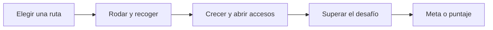
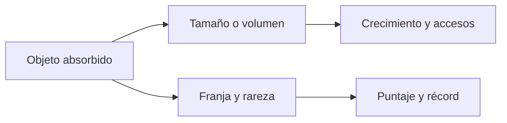
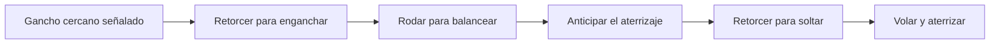
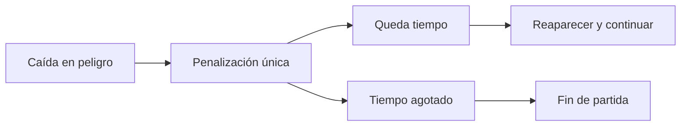
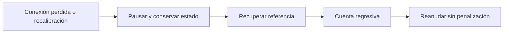

# Kyuboru

## Documento de diseño del juego

**Versión:** 0.1 · **Fecha:** 21 de octubre de 2026  
**Alcance:** Vertical Slice.

Este GDD establece la experiencia, las reglas y el alcance acordados para Kyuboru. Sirve como referencia compartida para programación, diseño de niveles, arte y pruebas. Describe el juego objetivo; no certifica que todas sus mecánicas estén implementadas.

Los valores de balance y las propuestas identificadas como provisionales requieren pruebas. El diseño de niveles se describe mediante necesidades y flujo conceptual, no como un mapa obligatorio.

## Índice

1. [Visión y pilares](#1-visión-y-pilares)
2. [Jugador y estructura de sesión](#2-jugador-y-estructura-de-sesión)
3. [Control e interacciones](#3-control-e-interacciones)
4. [Movimiento crecimiento y absorción](#4-movimiento-crecimiento-y-absorción)
5. [Puntuación y rareza](#5-puntuación-y-rareza)
6. [Ganchos y balanceo](#6-ganchos-y-balanceo)
7. [Plataformas obstáculos y peligros](#7-plataformas-obstáculos-y-peligros)
8. [Objetivos tiempo y récords](#8-objetivos-tiempo-y-récords)
9. [Cámara y comunicación visual](#9-cámara-y-comunicación-visual)
10. [Preparación pausa y reanudación](#10-preparación-pausa-y-reanudación)
11. [Diseño conceptual de niveles](#11-diseño-conceptual-de-niveles)
12. [Identidad audiovisual](#12-identidad-audiovisual)
13. [Alcance de la vertical slice](#13-alcance-de-la-vertical-slice)
14. [Parámetros y decisiones abiertas](#14-parámetros-y-decisiones-abiertas)
15. [Validación del diseño](#15-validación-del-diseño)

## 1 Visión y pilares

### Concepto

Kyuboru es un juego de habilidad y recorrido inspirado en Katamari. El jugador hace rodar una pelota física para conducir una pelota virtual que absorbe objetos y crece. El crecimiento permite acceder a nuevos sectores; ganchos, aceleradores y peligros ponen a prueba el dominio del movimiento.

El diferencial prioritario combina la manipulación física con el balanceo y la elección del momento de soltarse de un gancho. No se atribuye novedad absoluta a sus componentes aislados: la identidad se construye con su integración y con la experiencia de control.

### Experiencia esencial

El jugador pasa de familiarizarse con la pelota a ejecutar recorridos y saltos con intención. Aprende a regular el movimiento, preparar una trayectoria y aprovechar oportunidades bajo presión temporal, con márgenes compatibles con un gesto físico humano.

**Sensaciones objetivo:** dominio, tensión y satisfacción.

### Pilares

- **Movimiento físico continuo.** Para impulsar el movimiento hay que seguir rodando; mantener una inclinación no equivale a sostener un stick.
- **Comer permite crecer.** Crecer habilita nuevos objetos y accesos dentro del recorrido.
- **Nuevos lugares amplían las posibilidades.** A largo plazo abren niveles temáticos y mecánicas particulares. La entrega concentra el trabajo en un recorrido completo.
- **Dominar el control permite superar desafíos.** El tamaño abre posibilidades, pero no reemplaza la ejecución de ganchos y trayectorias.
- **Consecuencias comprensibles y recuperación amable.** Los errores cuestan tiempo o recorrido sin destruir lo recolectado.

## 2 Jugador y estructura de sesión

Se busca una experiencia individual, accesible a quien todavía no conoce el controlador. Las sesiones duran aproximadamente **10 a 20 minutos según el nivel**. La duración objetivo de sesión y el límite exacto del reloj son parámetros relacionados, pero no necesariamente iguales.

La dificultad pertenece al nivel. No existe un selector global de dificultad. El perfil demográfico específico del público aún no está cerrado; las categorías internas no constituyen por sí mismas una clasificación por edades.

### Ciclos de juego

El recorrido se repite con nuevas oportunidades hasta cerrar el objetivo de la sesión.

- **Segundos:** observar una situación, rodar o interactuar, recibir feedback y ajustar el movimiento.
- **Minutos:** recoger, crecer, acceder a otro sector y superar un conjunto de obstáculos.
- **Sesión:** cumplir una meta o alcanzar una puntuación, recibir el resultado y comparar intentos.
- **Progresión futura:** nuevos niveles temáticos con desafíos y mecánicas específicas. No se ha definido una campaña ni persistencia de crecimiento entre niveles.

## 3 Control e interacciones

La pelota física gira dentro de una caja fija. El sensor, la ESP32 y el circuito inalámbrico estarán dentro de la pelota. El jugador controla el juego mediante sus movimientos, sin depender de teclas para las acciones de la experiencia final.

| Contexto | Rodar | Retorcer alrededor del eje vertical |
|---|---|---|
| Suelo | Impulsar el desplazamiento | Activar la interacción contextual señalada |
| Gancho al alcance | Acercarse o ajustar la posición | Engancharse al candidato seleccionado |
| Colgado | Impulsar o frenar el balanceo | Soltarse |
| Menús y resultados | Cambiar la opción seleccionada | Confirmar |

Retorcer significa una rotación sobre el eje vertical de referencia, como una perilla. No es una aceleración vertical ni un desplazamiento de la pelota.

### Reglas de lectura

Solo se ofrece una interacción contextual a la vez. El objeto seleccionado se señala antes del gesto. Un retorcimiento genera una única activación y el detector espera a que termine antes de rearmarse. Entrar en un menú descarta entradas previas y requiere reposo antes de aceptar un gesto nuevo.

La sensibilidad, el umbral, la duración aceptada y el rearme son configurables. No se fija todavía un gesto distinto por sentido de retorcimiento. Se debe comprobar que rodar normalmente no genere activaciones accidentales.

## 4 Movimiento crecimiento y absorción

### Respuesta del movimiento

La intensidad de rodado controla la intención de desplazamiento. El control conserva una respuesta consistente entre tamaños. El punto de partida es equivalente; se permite una sensación leve de peso al crecer sin pérdida importante de agilidad.

Aceleración, frenado y velocidad máxima según tamaño serán parametrizables. Sonido y animación pueden comunicar peso sin introducir una demora excesiva. Dejar de rodar deja de aportar impulso: el comportamiento de frenado de la pelota virtual depende de los parámetros físicos, no de una orden de movimiento sostenida por inclinación.

### Absorción y crecimiento

Solo se absorben objetos habilitados por el tamaño actual. Cada objeto aporta crecimiento en función de su tamaño o volumen. Su rareza no aumenta ese aporte. Los objetos recogidos permanecen asociados visualmente a la pelota.

Crecer permite absorber nuevas franjas de objetos y superar barreras de tamaño. Las condiciones exactas de absorción y la curva de crecimiento deben ser legibles y configurables.

### Colisiones

Los contactos normales bloquean o desvían. Los choques fuertes producen un rebote y feedback visual y sonoro. **No desprenden objetos ni reducen tamaño o puntaje en esta entrega.** El tiempo se pierde al recuperar el movimiento, sin una resta explícita por cada choque.

## 5 Puntuación y rareza

### Dos sistemas independientes

**Crecimiento y puntuación son sistemas independientes.** El crecimiento depende del tamaño o volumen absorbido. El puntaje depende de una franja de tamaño y de la rareza del objeto.

Esta separación es principalmente una **herramienta para diseñar el nivel**. Permite ajustar el ritmo de crecimiento y distribuir recompensas sin que cambiar uno obligue a cambiar el otro. No se requiere que el jugador conozca la fórmula ni que elija conscientemente entre maximizar volumen y puntos.

Un objeto raro puede premiar un desvío o una ejecución exigente sin habilitar antes de tiempo la siguiente escala de crecimiento.

### Curva de valor

El valor aumenta por saltos entre franjas de tamaño para que desbloquear nuevos objetos produzca un aumento sorprendente del marcador. Dentro de cada franja hay rarezas con valores distintos.

**Modelo de balance:** puntaje del objeto = valor base de su franja × multiplicador de rareza.

Los multiplicadores, el número de rarezas y los valores base están pendientes de balance. No se adoptan como definitivos los ejemplos numéricos conversados. El puntaje no equivale linealmente al volumen.

El gancho no concede puntos por repetir balanceos: permite acceder a oportunidades de recolección. Los combos y bonos de recorrido no forman parte del alcance acordado.

## 6 Ganchos y balanceo

### Selección y enganche

El juego selecciona el gancho válido más cercano. La validación incluye alcance y línea libre hasta la pelota. Un único candidato se resalta con una indicación de retorcimiento. Acercarse no engancha automáticamente; el jugador debe ejecutar el gesto.

Un gancho puede tener restricciones de tamaño cuando el nivel las necesite, siempre comunicadas. No se establece una restricción universal por tamaño. La estabilidad de selección entre candidatos cercanos debe probarse para evitar parpadeos o cambios inesperados.

### Balanceo

Cada gancho define un plano de balanceo. Los planos pueden variar entre ganchos. Rodar la pelota aplica impulso sobre ese plano: a favor aumenta la oscilación y en contra la frena. No se usa mantener el sensor inclinado como un stick.

Al dejar de rodar se conserva la inercia y se pierde energía gradualmente. La amortiguación debe ser amable para permitir acomodar las manos y retorcer. La mecánica no exige un esfuerzo físico continuo para sostener una oportunidad de salida.

### Soltarse y anticipar la llegada

Otro retorcimiento suelta la cuerda conservando la velocidad del balanceo. La base acordada no agrega un salto extra. La salida se permite a cualquier velocidad; el indicador orienta, no bloquea la decisión.

Un marcador en el mundo muestra el aterrizaje previsto al soltarse en ese momento. Se vuelve verde, con un símbolo adicional, cuando permite alcanzar una recepción segura. Debe contemplar la asistencia realmente aplicada al salto.

La ventana favorable será suficientemente amplia para cambiar de gesto. Una pérdida lenta de energía no basta: la dirección del péndulo cambia aunque conserve velocidad. El tamaño de la recepción y una corrección limitada de salida deben ofrecer tolerancia sin congelar el balanceo ni esperar automáticamente por el jugador.

La implementación concreta de la asistencia, sus límites y qué recepción se considera válida requieren prototipo. El verde no debe prometer una llegada incompatible con la física real del salto.

### Consecuencias

El gancho no impone una penalización propia. Aterrizar sobre piso o una ruta inferior permite continuar desde allí. Aterrizar en un peligro aplica las reglas de ese peligro, igual que si se llegara rodando.

## 7 Plataformas obstáculos y peligros

### Plataformas aceleradoras

Son elementos del escenario, no pickups ni acciones de retorcimiento. Se activan al pasar por encima y dan un impulso en la **dirección marcada por la plataforma**, controlada por el diseñador.

La fuerza es configurable por instancia. Después del impulso se conserva capacidad de corrección y frenado. Cada pasada produce una activación; permanecer encima no acumula aceleración ilimitadamente. Rectas, rampas y cruces pueden reutilizar esta regla.

### Obstáculos

Los niveles pueden incorporar obstáculos que hagan perder tiempo al bloquear, desviar o exigir una ejecución. Las barreras temporizadas son una posibilidad de diseño, no una familia obligatoria ya aprobada para todos los niveles. El temporizador general proporciona presión; no todos los errores descuentan segundos directamente.

### Peligros y recuperación

Una caída en lava u otro peligro definido por el nivel desencadena esta secuencia:

1. Registrar una única penalización de tiempo por incidente.
2. Si agota el tiempo restante, terminar la partida.
3. En otro caso, reaparecer en el último punto seguro activado, conservando tamaño, objetos y puntaje.
4. Reaparecer detenido y desenganchado; acomodar la cámara antes de devolver el control.

Durante la transición de recuperación el reloj no avanza. Se paga la penalización explícita, no además la duración de la animación. El sistema debe impedir múltiples cobros por contactos repetidos durante la misma caída o recuperación.

### Puntos seguros

Son zonas automáticas colocadas por diseño. No requieren retorcer ni confirmar. Cada una establece una posición válida con espacio suficiente para el tamaño posible de la pelota en ese tramo. Se ubican antes de desafíos importantes para evitar repetir largos segmentos de recolección.

El nivel necesita un punto inicial de recuperación y no debe permitir reaparecer en un peligro o dentro de geometría. Son criterios de implementación que deben verificarse en cada nivel.

## 8 Objetivos tiempo y récords

### Modalidades de objetivo

| Modalidad | Objetivo | Finalización |
|---|---|---|
| Meta | Alcanzar un destino antes del límite | Llegar produce victoria; agotar el tiempo produce fracaso |
| Puntaje | Reunir puntuación durante el tiempo disponible | Al finalizar se compara el total con el mínimo definido por nivel |

El tamaño habilita oportunidades y accesos, pero no es una condición universal de victoria. Los niveles de meta pueden usarlo como requisito del recorrido. Los niveles de puntaje ofrecen sectores y objetos con recompensas diferentes. Rangos adicionales de desempeño son opcionales y no están definidos todavía.

### Relojes

Sea **T** el tiempo de simulación activa desde el inicio, **P** la suma de penalizaciones y **L** el límite del nivel:

- Tiempo restante = máximo entre cero y **L − T − P**.
- Tiempo de llegada de Race = **T + P** al alcanzar la meta.

T excluye las pausas por desconexión o recalibración y las transiciones de reaparición. La cuenta regresiva inicial y la de reanudación tampoco consumen tiempo de juego. El balanceo y la espera normal dentro del nivel sí lo consumen.

Así, una penalización afecta tanto al reloj disponible como a la marca comparada, pero se suma una sola vez en cada cálculo. No se vuelve a descontar al finalizar.

### Récords locales

Race es contrarreloj individual: se conserva localmente el mejor tiempo de llegada de cada nivel. Los niveles de puntuación conservan su mejor puntaje. No hay cuentas, rivales online ni tablas globales en esta entrega.

Los intentos fallidos de Race no son marcas de llegada. La política de récord para puntuaciones inferiores al mínimo y la invalidación de marcas tras cambios de balance quedan por precisar. Se recomienda identificar los récords por nivel y versión de reglas.

## 9 Cámara y comunicación visual

### Cámara siempre automática

La cámara **nunca se mueve manualmente**. Durante el desplazamiento normal sigue a la pelota con un offset y orienta progresivamente el encuadre hacia la dirección de avance, con un pequeño retraso configurable. Al detenerse conserva una orientación estable; pequeñas fluctuaciones no deben hacerla oscilar.

Al engancharse transiciona a un encuadre definido por gancho que muestra el plano de balanceo y la recepción. Durante el vuelo conserva la lectura del destino y vuelve gradualmente al seguimiento al aterrizar. Otros sectores, como aceleradores, pueden definir encuadres particulares si son necesarios.

**Las transiciones de cámara no cambian la dirección del control.** Un movimiento de manos que ya estaba ejecutándose no se reinterpreta por la rotación del encuadre. El marco de referencia entre dispositivo, mundo y cámara debe resolverse explícitamente en la integración, manteniendo esta condición de aceptación.

### HUD y feedback en el mundo

- Tiempo restante, objetivo y puntaje acumulado visibles.
- En puntaje, mínimo requerido; en meta, comunicación del destino.
- Tamaño actual y señal breve de umbrales relevantes de crecimiento.
- Resaltado del gancho elegido e indicación del gesto disponible.
- Predicción de aterrizaje, verde y símbolo para la ventana favorable.
- Cada objeto absorbido produce **+X en worldspace donde se recogió**, además de actualizar el marcador.
- Una trampa produce **−X s en worldspace donde ocurrió la penalización**, una vez por incidente, y actualiza el reloj.

Los textos miran hacia la cámara, flotan brevemente y desaparecen. La rareza recibe énfasis adicional. La densidad y colocación deben evitar tapar el indicador de aterrizaje, la interacción o el recorrido. El signo y la unidad distinguen puntos ganados de segundos perdidos.

### Resultados y menús

Los resultados muestran victoria o fracaso, puntaje y la información temporal pertinente. Race compara el tiempo del intento con el récord local; puntaje compara total, mínimo y mejor registro. Se ofrece reintentar mediante selección por rodado y confirmación por retorcimiento.

## 10 Preparación pausa y reanudación

### Inicio

El jugador coloca la marca física de la pelota en la referencia conocida, con el sensor horizontal y componentes hacia arriba, y permanece quieto. La interfaz indica el progreso de preparación. La marca también comunica el frente: la gravedad por sí sola no fija el rumbo hacia la pantalla.

Cuando el control está listo se realiza una cuenta regresiva breve y comienza la simulación con su temporizador. La preparación debe comunicar claramente si está esperando quietud o posición.

### Interrupción del dispositivo

Perder la conexión o requerir recalibración pausa **toda la simulación**, incluido el balanceo y el temporizador. Se conserva el estado para reanudar. No se aplica una penalización por un problema del dispositivo.

Tras recuperar la referencia se realiza una cuenta regresiva breve antes de devolver el control. La pausa debe conservar velocidades, vínculo del gancho, estados de obstáculos y progreso de forma coherente. Reaparecer tras tocar lava no obliga por sí mismo a recalibrar.

## 11 Diseño conceptual de niveles

### Categorías internas

No se muestran al jugador ni actúan como opciones de dificultad.

| Categoría | Intención de diseño |
|---|---|
| Kids | Accesibilidad, aprendizaje y experimentación con situaciones claras y márgenes generosos |
| Puzzle | Problemas espaciales que combinan las mecánicas generales con elementos específicos, como interruptores o colocación de objetos; dos niveles pueden utilizar herramientas totalmente distintas |
| Race | Velocidad, continuidad y dominio de trayectorias en contrarreloj individual, comparando tiempos de llegada |

Puzzle no implica necesariamente mayor exigencia motriz que Kids. Cada nivel define su exigencia de ejecución y de resolución. Interruptores y colocación de objetos son posibilidades particulares, no sistemas generales comprometidos para la vertical slice. Cualquier mecánica especial debe poder operarse con la pelota y respetar la claridad de la interacción contextual.

### Flujo orientativo

1. Aprender a rodar y recoger en una zona de bajo riesgo.
2. Percibir que crecer habilita un acceso antes inaccesible.
3. Aprender el gancho sobre suelo seguro, con recepción amplia.
4. Combinar mecánicas y elegir recorridos con distinta exigencia.
5. Resolver un desafío final o concentrar la recolección según el objetivo.

Este flujo es una propuesta de ritmo, no una distribución espacial obligatoria. El diseñador decide ubicaciones y conexiones. Las sesiones de 10 a 20 minutos necesitan pausas de intensidad y zonas donde se pueda dejar de rodar sin peligro inmediato; eso no equivale a detener el reloj.

### Ficha por nivel

Cada nivel debe registrar: categoría interna, modalidad de objetivo, duración prevista, límite de tiempo, mínimo de puntos si corresponde, tamaño inicial, curva de recolección, accesos por tamaño, ganchos y recepciones, aceleradores, peligros y penalizaciones, puntos seguros, cámaras, mecánicas especiales y criterios de prueba.

## 12 Identidad audiovisual

Kyuboru mantiene como antecedente conceptual el humor y la identidad argentina, junto con los bocetos del Pibe Rodante. Estos antecedentes no equivalen a un personaje final aprobado ni obligan a introducir narrativa adicional para esta entrega.

El entorno urbano utiliza objetos cotidianos, mobiliario, vehículos y edificios para comunicar cambios de escala. La dirección visual debe mantener legibilidad de objetos absorbibles, interacciones y peligros por encima de la cantidad de decoración.

El sonido comunica rodado, recolección, crecimiento, enganche, oportunidad favorable, salida y penalización. Las señales críticas tienen respaldo visual. No se define una banda sonora nueva ni una historia completa en esta versión.

## 13 Alcance de la vertical slice

### Compromiso de la vertical slice

Una experiencia individual completa desde menú y preparación hasta resultado y reintento. Incluye movimiento, absorción, crecimiento, puntuación con rareza independiente, gancho con balanceo y predicción, plataformas direccionales, peligros, recuperación, cámara automática, pausa del dispositivo y récords locales.

Se prioriza un recorrido terminado y una modalidad principal, con reglas configurables para los otros objetivos. La cantidad final de niveles y qué modalidades se entregarán jugables deben cerrarse con el equipo. Una mecánica descrita para futuros niveles no aumenta automáticamente este compromiso.

### Fuera del alcance prioritario

- Cambio general de tamaño a voluntad.
- Estaciones contextuales de cambio de tamaño, posibles a futuro con escalas preestablecidas y adaptación visual de objetos pegados.
- Adherencia, reservada para situaciones de niveles particulares.
- Niveles temáticos adicionales, multijugador y clasificaciones online.
- Combos, poderes por categoría y acumulación de funcionalidades sin validar el núcleo.
- Control manual de cámara y desprendimiento por golpes.

## 14 Parámetros y decisiones abiertas

| Sistema | Parámetros por ajustar |
|---|---|
| Control | Sensibilidad, zonas muertas, retorcimiento, rearme, detección de conexión y preparación |
| Rodado | Aceleración, frenado, máxima velocidad y variación suave con tamaño |
| Crecimiento | Umbrales de absorción, aporte de volumen y acceso a escalas |
| Puntaje | Franjas, valores base, rarezas, multiplicadores y mínimos por nivel |
| Gancho | Alcance, plano, longitud, impulso, amortiguación, asistencia y ventana favorable |
| Plataforma | Dirección, fuerza, condición de reactivación y corrección posterior |
| Peligros | Penalización por incidente, duración de recuperación y punto seguro |
| Cámara | Offset, retraso, suavizado, distancia por tamaño y encuadres contextuales |
| Presentación | Duración y separación de textos, señales y cuentas regresivas |

Las constantes de producción deben poder ajustarse sin reescribir las reglas. No se fija todavía un valor numérico de asistencia, penalización o puntuación por falta de playtest. Las tolerancias del dispositivo y del gesto no deben deducirse de latencias supuestas.

Pendientes de cierre: modalidad principal de la entrega; selección estable entre ganchos próximos; algoritmo de asistencia y validez del indicador; marco de control independiente de cámara; resolución de llegada y agotamiento simultáneos; política de récord de puntaje bajo el mínimo; conservación o reinicio de registros al cambiar balance; acciones especiales concretas de un eventual nivel Puzzle.

## 15 Validación del diseño

### Pruebas prioritarias

**Control e interacción.** Observar si alguien nuevo distingue rodar de retorcer, si cambia de gesto cómodamente y si confirma por accidente al entrar en un menú. Medir activaciones involuntarias y gestos no reconocidos.

**Gancho.** Usar un gancho fijo en un plano y recepción amplia. Comprobar si el jugador aprende a ganar impulso, entiende el marcador y elige cuándo soltarse. Registrar salidas, aterrizajes y discrepancias entre verde y resultado; preguntar después si sintió control sobre el salto.

**Conservación de referencia.** Comprobar que, tras varios giros, el movimiento siga respondiendo a la dirección esperada y que la recalibración permita recuperar esa referencia de forma comprensible.

**Cámara.** Repetir la misma entrada durante seguimiento, enganche y vuelo. Verificar que las transiciones no cambien su dirección y que el destino siga siendo legible.

**Sesión completa.** Probar duración de 10 a 20 minutos con personas ajenas al desarrollo. Observar cansancio, descansos espontáneos, confusión sobre objetivos y repetición de fallos. Preguntar comodidad y motivos de abandono después de jugar, sin dirigir el intento.

### Condiciones funcionales de aceptación

- Un golpe no reduce tamaño, objetos ni puntaje.
- Una caída en un peligro cobra una sola penalización y reaparece en una zona válida.
- Una desconexión conserva el estado completo, congela el reloj y permite reanudar sin penalización.
- La rareza modifica puntos, no crecimiento.
- Una plataforma impulsa en su dirección configurada, una vez por pasada.
- Un retorcimiento no engancha y suelta en el mismo gesto ni confirma una pantalla recién abierta.
- El tiempo Race suma penalizaciones y excluye pausas y recuperaciones.
- Los récords son locales y pertenecen al nivel correspondiente.
- La predicción y la asistencia del gancho describen la misma salida física.

Si el gancho falla en control o legibilidad, se simplifican geometría, tolerancias y condiciones del desafío antes de agregar variantes. Las mecánicas futuras no sustituyen la validación del núcleo.

